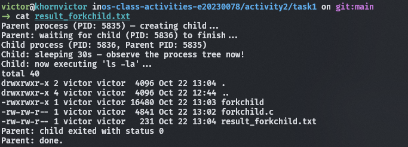
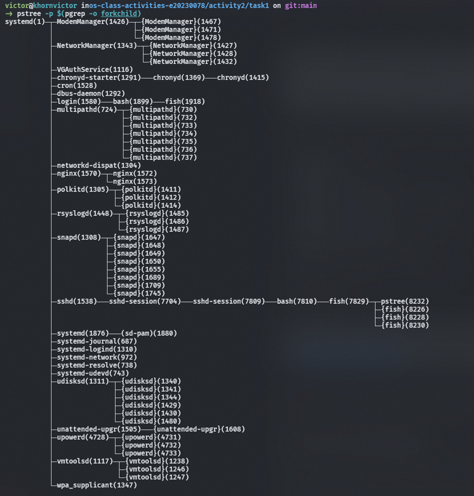
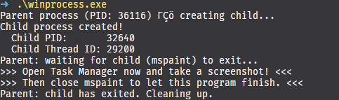
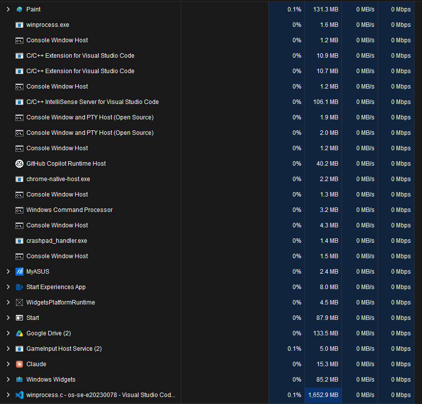
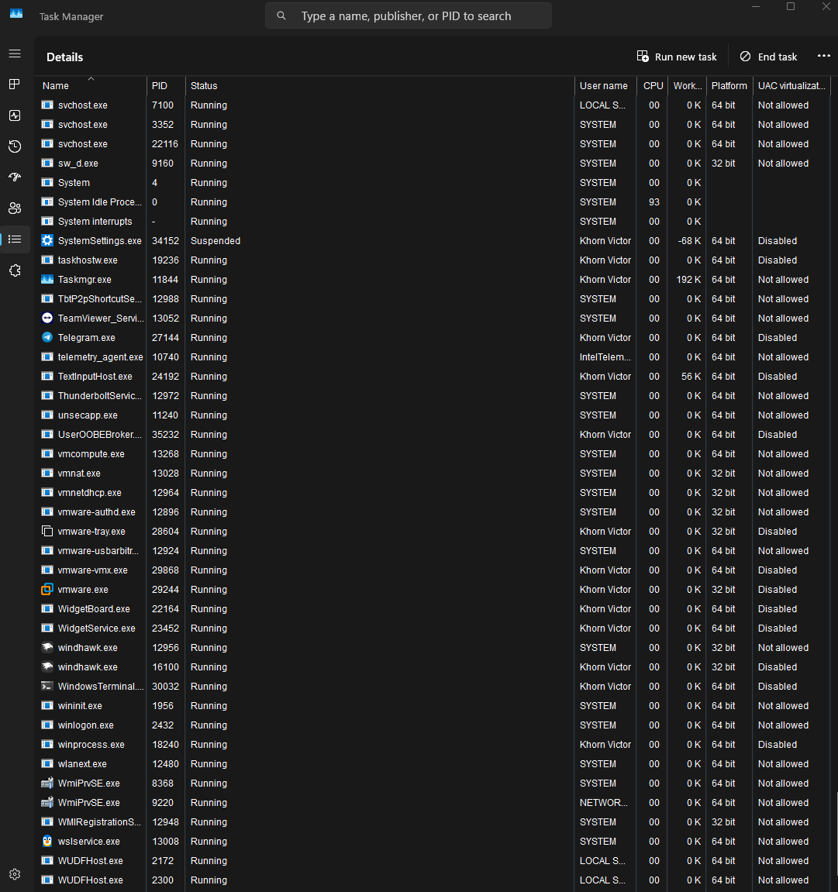
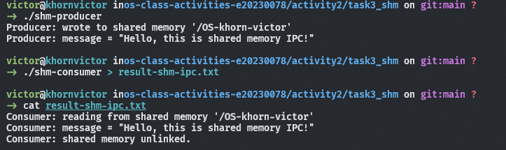
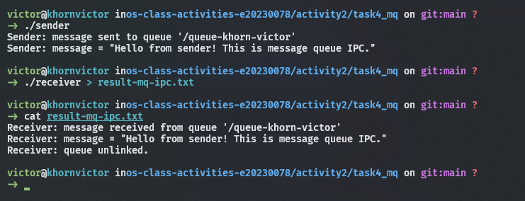

# Class Activity 2 — Processes & Inter-Process Communication

- **Student Name:** KHORN VICTOR
- **Student ID:** e20230078
- **Date:** 23/10/2026

---

## Task 1: Process Creation on Linux (fork + exec)

### Compilation & Execution

Screenshot of compiling and running `forkchild.c`:



### Process Tree

Screenshot of the parent-child process tree (using `ps --forest`, `pstree`, or `htop` tree view):



### Output

```bash
Parent process (PID: 5835) — creating child...
Parent: waiting for child (PID: 5836) to finish...
Child process (PID: 5836, Parent PID: 5835)
Child: sleeping 30s — observe the process tree now!
Child: now executing 'ls -la'...
total 40
drwxrwxr-x 2 victor victor  4096 Oct 22 13:04 .
drwxrwxr-x 4 victor victor  4096 Oct 22 12:44 ..
-rwxrwxr-x 1 victor victor 16480 Oct 22 13:03 forkchild
-rw-rw-r-- 1 victor victor  4841 Oct 22 13:02 forkchild.c
-rw-rw-r-- 1 victor victor   231 Oct 22 13:04 result_forkchild.txt
Parent: child exited with status 0
Parent: done.
```

### Questions

1. **What does `fork()` return to the parent? What does it return to the child?**

   > The fork() function creates a new child process. It returns the child's PID (a positive integer) to the parent process, 0 to the child process, and -1 if the process creation fails.

2. **What happens if you remove the `waitpid()` call? Why might the output look different?**

   > If we remove waitpid(), the parent process does not wait for the child to finish. The parent may terminate before the child completes its execution, so the output order may be different. If the child finishes while the parent is still running, it may temporarily become a zombie process until its exit status is collected.

3. **What does `execlp()` do? Why don't we see "execlp failed" when it succeeds?**

   > The execlp() function replaces the current process program with a new program. In this task, it replaces the child process program with ls -la, which lists files and directories in detail. When execlp() succeeds, it does not return to the original program, so the error message is not printed. If it fails, it returns -1, and perror() displays the error.

4. **Draw the process tree for your program (parent → child). Include PIDs from your output.**

   > The process tree shows that the parent process creates a child process using fork(). The child's PPID matches the parent's PID. After 30 seconds, the child executes ls -la but keeps the same PID.

   ```text
   forkchild (Parent PID: 12345)
   └── forkchild (Child PID: 12346)
   ```

   > Important: 12345 and 12346 are example PIDs. Replace them with your actual PIDs. During the 30-second sleep, both processes appear as forkchild. After execlp() succeeds, the child appears as ls instead.

5. **Which command did you use to view the process tree (`ps --forest`, `pstree`, or `htop`)? What information does each column show?**

   > I used the command ps -ef --forest | grep -E 'forkchild|PID' to view the parent-child process relationship. The forest view uses indentation to show which process is the parent and which is the child.

---

## Task 2: Process Creation on Windows

### Compilation & Execution

Screenshot of compiling and running `winprocess.c`:



### Task Manager Screenshots

Screenshot showing process tree in the **Processes** tab (mspaint nested under your program):



Screenshot showing PID and Parent PID in the **Details** tab:



### Questions

1. **What is the key difference between how Linux creates a process (`fork` + `exec`) and how Windows does it (`CreateProcess`)?**

   > Linux separates process creation into two distinct phases: fork() clones the calling parent process to create an identical child with a duplicated address space and descriptor table, and exec() subsequently wipes and replaces that address space with a new executable image. In contrast, Windows combines this entire workflow into a single API call, CreateProcess(). It directly instantiates a fresh address space, loads the target binary from disk, initializes the primary thread, and begins execution without cloning the parent.

2. **What does `WaitForSingleObject()` do? What is its Linux equivalent?**

   > WaitForSingleObject() pauses execution of the calling parent thread until the specified kernel object—in this case, the child process handle—enters a signaled state, which happens automatically when the child terminates. Its direct Linux equivalent is the wait() or waitpid() system call.

3. **Why do we need to call `CloseHandle()` at the end? What happens if we don't?**

   > When CreateProcess() succeeds, the operating system creates kernel objects for the process and its primary thread and returns open handles to them, which increments their reference counts. Calling CloseHandle() releases the parent's reference to these kernel structures. If you don't call it, the kernel cannot free the underlying bookkeeping structures (such as process exit codes and accounting blocks) even after the child process has finished running, causing a kernel resource leak until the parent process itself exits.

4. **In Task Manager, what was the PID of your parent program and the PID of mspaint? Do they match your program's output?**

   > In my run, the parent process (winprocess.exe) had a PID of 21280, and the child process (mspaint.exe) had a PID of [insert your child PID, e.g., 14824]. These values match the program's console output (GetCurrentProcessId() and pi.dwProcessId) as well as the PID and Parent PID (PPID) columns shown in Task Manager.

5. **Compare the Processes tab (tree view) and the Details tab (PID/PPID columns). Which view makes it easier to understand the parent-child relationship? Why?**

   > The Processes tab (tree view) is generally easier for human visual understanding because it renders the hierarchy directly as an expandable, indented tree structure, making parent-child ownership obvious at a glance. However, the Details tab (PID/PPID columns) is more precise and reliable for technical verification because it displays the exact numeric process IDs without application grouping or UI abstraction.

---

## Task 3: Shared Memory IPC

### Compilation & Execution

Screenshot of compiling and running `shm-producer` and `shm-consumer`:



### Output

```
[Paste the content of result-shm-ipc.txt here]
```

### Questions

1. **What does `shm_open()` do? How is it different from `open()`?**

   > [Your answer]

2. **What does `mmap()` do? Why is shared memory faster than other IPC methods?**

   > [Your answer]

3. **Why must the shared memory name match between producer and consumer?**

   > [Your answer]

4. **What does `shm_unlink()` do? What would happen if the consumer didn't call it?**

   > [Your answer]

5. **If the consumer runs before the producer, what happens? Try it and describe the error.**

   > [Your answer]

---

## Task 4: Message Queue IPC

### Compilation & Execution

Screenshot of compiling and running `sender` and `receiver`:



### Output

```
[Paste the content of result-mq-ipc.txt here]
```

### Questions

1. **How is a message queue different from shared memory? When would you use one over the other?**

   > [Your answer]

2. **Why does the queue name in `common.h` need to start with `/`?**

   > [Your answer]

3. **What does `mq_unlink()` do? What happens if neither the sender nor receiver calls it?**

   > [Your answer]

4. **What happens if you run the receiver before the sender?**

   > [Your answer]

5. **Can multiple senders send to the same queue? Can multiple receivers read from the same queue?**

   > [Your answer]

---

## Reflection

What did you learn from this activity? What was the most interesting difference between Linux and Windows process creation? Which IPC method do you prefer and why?

> [Write your reflection here]
