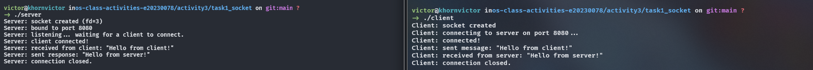
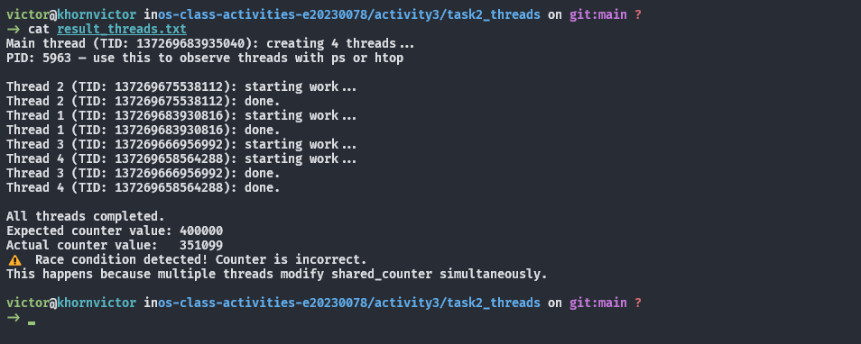
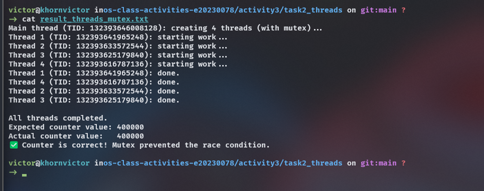
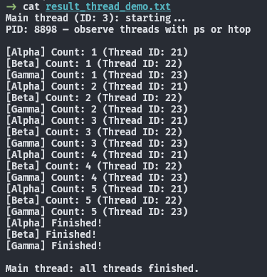
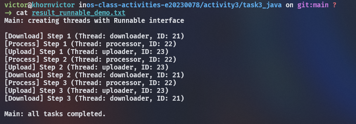
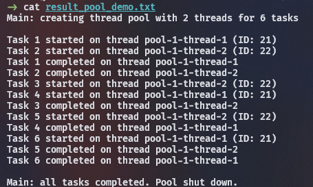
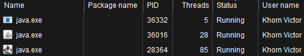

# Class Activity 3 — Socket Communication & Multithreading

- **Student Name:** KHORN VICTOR
- **Student ID:** e20230078
- **Date:** 1/11/2026

---

## Task 1: TCP Socket Communication (C)

### Compilation & Execution

### Answers

1. **Role of `bind()` / Why client doesn't call it:**

   > In the server program, bind() ties an unnamed socket file descriptor to a specific local address and port number (such as INADDR_ANY on port 8080). This step is essential because the operating system needs to know which incoming traffic to direct to the server process. In contrast, the client typically does not call bind() because it initiates the communication rather than waiting on a fixed, well-known port. When the client invokes connect(), the operating system automatically assigns an ephemeral, unused local port and the appropriate local IP address to the client's socket.

2. **What `accept()` returns:**
   > When incoming connections arrive, accept() pulls the first completed connection request from the listen queue and returns a brand-new socket file descriptor dedicated exclusively to that client. The original server socket (server_fd) remains in the LISTEN state, acting purely as a gatekeeper that waits for and queues up subsequent connection attempts. In contrast, the newly returned socket (client_fd) is an active, fully connected socket configured for two-way communication, handling all actual data transfer operations like read() and send() with that specific client.

3. **Starting client before server:**
   > If the client is started before the server is running, the client's connect() system call fails immediately with the error connect: Connection refused. This occurs because the client sends a TCP SYN packet to port 8080 to begin the three-way handshake, but the host operating system finds no active process listening on that destination port. Consequently, the operating system's networking stack rejects the attempt by replying with a TCP RST (reset) packet, causing connect() to return -1 and set errno to ECONNREFUSED.

4. **What `htons()` does:**
   > The function htons() (Host to Network Short) converts a 16-bit unsigned integer from host byte order to standard network byte order. This conversion is necessary because different processor architectures store multi-byte numbers using different endianness; for instance, modern x86 and ARM systems commonly use little-endian format (storing least significant bytes first), whereas TCP/IP protocols mandate big-endian format (storing most significant bytes first). Without conversion, a port value such as 8080 (0x1F90) on a little-endian host would be transmitted over the wire in reverse order as 0x901F, which the receiving side would misinterpret as port 36912.

5. **Socket call sequence diagram:**
   > The communication sequence begins with both the server and client creating endpoints via socket(). The server then binds itself to a designated IP address and port using bind(), places the socket into a passive waiting state with listen(), and blocks on accept() awaiting incoming traffic. The client triggers the TCP three-way handshake by calling connect(), which unblocks the server's accept() call and yields a dedicated connection socket. Once connected, the client transmits its message using send(), and the server receives it through read(). The server then issues a response using send(), which the client captures via its own read(). Finally, both sides gracefully terminate the connection by calling close() on their respective socket descriptors.

---

## Task 2: POSIX Threads (C)

### Output — Without Mutex (Race Condition)

### Output — With Mutex (Correct)

### Answers

1. **What is a race condition?**
   > A race condition occurs in concurrent programming when multiple execution threads access and mutate shared data concurrently, and the final outcome depends unpredictably on the order and timing of thread scheduling. In threads.c, the operation shared_counter++ looks like a single line of C code, but at the assembly and hardware level it is non-atomic and consists of three distinct instructions: reading the current value of shared_counter from memory into a CPU register, incrementing the value inside the register, and writing the updated register value back out to memory. When multiple threads execute this sequence without synchronization, thread context switches occur mid-operation; one thread can read a stale counter value before another thread finishes writing its update, causing overlapping increments to overwrite each other and leaving the final count lower than the expected 400,000.

2. **What does `pthread_mutex_lock()` do?**
   > The pthread_mutex_lock() function attempts to acquire an exclusive lock on a mutual exclusion primitive (mutex); if another thread already holds the lock, the calling thread blocks and is placed in a sleep state by the OS scheduler until the mutex is released via pthread_mutex_unlock(). This guarantees mutual exclusion around the critical section where shared_counter++ executes, ensuring that exactly one thread at a time can perform the read-modify-write cycle. Because no other worker thread can interleave its execution or read intermediate values while the mutex is held, the increment behaves as an atomic operation, preserving every iteration and producing the correct final result of 400,000.

3. **Removing `pthread_join()`:**
   > The pthread_join() function suspends the execution of the calling thread (in this case, the main thread) until the target thread terminates, functioning as a synchronization barrier. If you omit pthread_join(), the main thread immediately proceeds past thread creation to print the counter results and reaches return 0 in main(). Returning from main() invokes exit(), which instantly terminates the entire process and kills all running child worker threads regardless of whether they have finished their loops. As a result, the program prints premature, erratic counter values (often near 0 or only a fraction of the total work), threads terminate halfway through, and their resources are not cleanly synchronized.

4. **Thread vs Process:**
   > A process is an independent execution unit that possesses its own dedicated, isolated virtual address space and operating system resources, whereas a thread is a lightweight unit of execution that exists within a process. Threads belonging to the same process share the virtual address space—including the global data section (such as shared_counter), heap memory, compiled code/text segment, open file descriptors, and OS signals—which makes communication extremely fast but prone to race conditions. In contrast, each individual thread maintains its own private execution context consisting of a unique thread ID (TID), a separate call stack (which holds local variables and function frames), a dedicated program counter (PC), and a private set of CPU registers.

---

## Task 3: Java Multithreading

### ThreadDemo Output

### RunnableDemo Output

### PoolDemo Output

### Answers

1. **Thread vs Runnable:**
   > The core architectural difference stems from Java’s single-inheritance model: extending the Thread class ties your class directly to the thread hierarchy and permanently exhausts your single inheritance slot, preventing you from subclassing any other domain class. Implementing the Runnable interface cleanly decouples the executable unit of work from the actual execution mechanism, allowing your class to inherit from a business base class and cleanly implement additional interfaces. You should prefer implementing Runnable in virtually all modern production scenarios because it fosters separation of concerns, enables code reuse, and integrates seamlessly with thread pooling architectures like ExecutorService. Extending Thread is typically only justified if you are specifically creating a specialized thread implementation that overrides core lifecycle methods of Thread itself.

2. **Pool size limiting concurrency:**
   > In PoolDemo, the thread pool is instantiated using Executors.newFixedThreadPool(2), which pre-allocates an executor backed by a fixed worker pool of exactly two operating threads and an unbounded internal FIFO blocking queue (LinkedBlockingQueue). When all six tasks are submitted in a rapid loop via pool.submit(), the pool assigns the first two tasks directly to its two available worker threads, which immediately begin executing their respective 1-second sleeps. Because both worker threads are now fully occupied, the remaining four tasks are placed into the blocking queue where they safely wait; as soon as a worker finishes its active task, it pulls the next queued task from the buffer, enforcing a strict concurrency throttle of at most two actively executing tasks at any given moment.

3. **thread.join() in Java:**
   > Calling thread.join() instructs the currently running thread (the main thread) to suspend its execution and transition into a waiting state until the specific target thread finishes executing its run() method and terminates. In ThreadDemo.java, calling t1.join(), t2.join(), and t3.join() guarantees that the counter loops in Alpha, Beta, and Gamma finish their 500ms sleep iterations before main resumes. If you remove the join() calls, the main thread will not block; it will immediately print "Main thread: all threads finished." right after calling .start(), while the background worker threads are still in the early stages of counting, causing out-of-order console output and potentially premature program winding down.

4. **ExecutorService advantages:**
   > Calling thread.join() instructs the currently running thread (the main thread) to suspend its execution and transition into a waiting state until the specific target thread finishes executing its run() method and terminates. In ThreadDemo.java, calling t1.join(), t2.join(), and t3.join() guarantees that the counter loops in Alpha, Beta, and Gamma finish their 500ms sleep iterations before main resumes. If you remove the join() calls, the main thread will not block; it will immediately print "Main thread: all threads finished." right after calling .start(), while the background worker threads are still in the early stages of counting, causing out-of-order console output and potentially premature program winding down.

---

## Task 4: Observing Threads

### Linux — `ps -eLf` Output

_(Paste the relevant ps output here)_

### Linux — htop Thread View

### Windows — Task Manager

### Answers

1. **LWP column meaning:**
   > _Your answer_

2. **/proc/PID/task/ count:**
   > _Your answer_

3. **Extra Java threads:**
   > _Your answer_

4. **Linux vs Windows thread viewing:**
   > _Your answer_

---

## Reflection

> _What did you find most interesting about socket communication and threading? How does understanding threads at the OS level help you write better concurrent programs?_