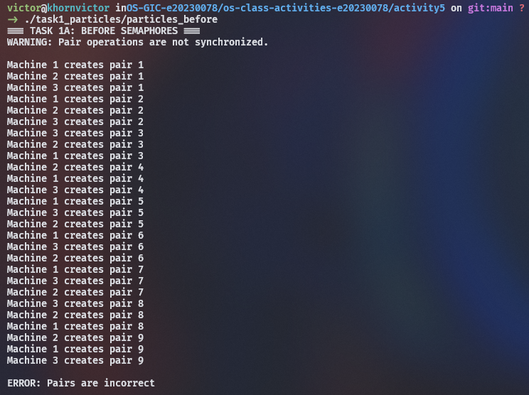
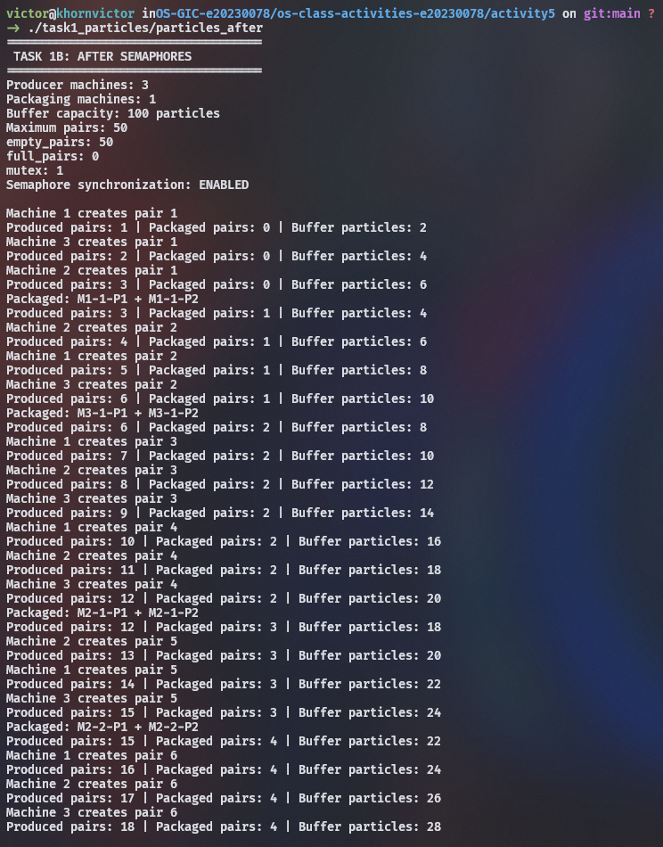
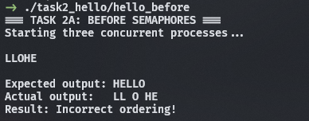
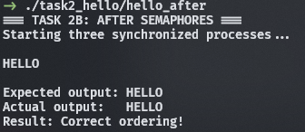

# Class Activity 5 - Semaphores

- **Student Name:** KHORN VICTOR
- **Student ID:** e20230078
- **Programming Language Used:** C

---

## Task 1A: Particle Pair Buffer Before Semaphores

- **What error or incorrect behavior appeared:**  
  The program stopped with the error `ERROR: Pairs are incorrect`. The consumer received mismatched particles that did not make a valid pair.

- **Why did this happen without semaphore protection:**  
  Producers added particle 1 and particle 2 in separate steps with a yield in between. Without synchronization, other producers jumped in and inserted their particles in the middle, breaking the pair order in the buffer.

---

## Task 1B: Particle Pair Buffer After Semaphores

- **Number of producer machines:** 3
- **Buffer capacity:** 100 particles (50 pairs)
- **Semaphores used:**
  - `empty_pairs` (starts at 50): counts empty pair slots.
  - `full_pairs` (starts at 0): counts available complete pairs.
  - `mutex` (starts at 1): locks the shared buffer for safe access.
- **Produced pair count shown in screenshot:** 18
- **Packaged pair count shown in screenshot:** 4
- **Did any error appear during normal operation?**  
  No, it ran smoothly without any errors.

---

## Task 2A: HELLO Before Semaphores

- **Output before semaphore ordering:** `LLOHE`
- **Why this output can be wrong or unpredictable:**  
  The three threads ran freely without any order, and their sleep times differed. Thread 2 woke up first and printed `"LL"`, then Thread 3 printed `"O"`, and Thread 1 printed `"HE"` last.

---

## Task 2B: HELLO After Semaphores

- **Processes or threads used:** 3 threads (`p1`, `p2`, `p3`)
- **Semaphores used:**
  - `after_e` (starts at 0): unblocks Thread 2 after `"HE"` is printed.
  - `after_ll` (starts at 0): unblocks Thread 3 after `"LL"` is printed.
- **Final output:** `HELLO`

---

## Questions

1. **In Task 1, why does a producer need to wait before adding a pair to the buffer?**  
   The buffer can only hold 50 pairs. The producer must wait on `empty_pairs` when the buffer is full so it does not overwrite unconsumed data or cause a buffer overflow.

2. **In Task 1, why does the consumer need to wait before removing a pair from the buffer?**  
   The consumer needs a full pair (2 particles) to package. It must wait on `full_pairs` when the buffer is empty so it does not read missing or invalid data.

3. **Which semaphore protects the critical section in your particle buffer program?**  
   The binary semaphore `mutex` (starts at 1). It ensures only one thread at a time can read or write to the shared buffer and update counters.

4. **How does your program verify that `P1` and `P2` belong to the same pair?**  
   The consumer checks that both particles have the same `machine` ID, the same `pair_id`, and that `p1.part == 1` while `p2.part == 2`. If any check fails, it raises an error.

5. **In Task 2, why can the program print letters in the wrong order without semaphores?**  
   Because threads run independently and unpredictably. The OS scheduler runs whichever thread is ready, and Thread 2's short sleep finished before Thread 1's sleep, making `"LL"` print before `"HE"`.

6. **Which semaphore or synchronization step forces `H` to print before `E`, `L`, `L`, and `O`?**  
   Inside Thread 1, `H` is printed sequentially before `E`. Then, the semaphore `after_e` (initialized to 0) forces Thread 2 to wait until Thread 1 prints `"HE"` and calls `sem_post(&after_e)`.

7. **What could cause deadlock in either of your simulations?**  
   In Task 1, locking `mutex` before waiting on `empty_pairs` would cause deadlock: a producer would hold the lock while sleeping, blocking the consumer forever. In Task 2, a circular dependency or forgetting to call `sem_post` would leave downstream threads waiting forever.

---

## Reflection

_What did these simulations teach you about using semaphores for shared resources and ordered execution?_

These simulations showed that semaphores serve two key purposes in multithreading: controlling shared resource limits and enforcing strict execution order. Counting semaphores prevent buffer overflow and underflow without wasting CPU time, a mutex keeps data safe by ensuring atomic updates, and zero-initialized semaphores act as simple signals to make independent threads run in the exact order required.
