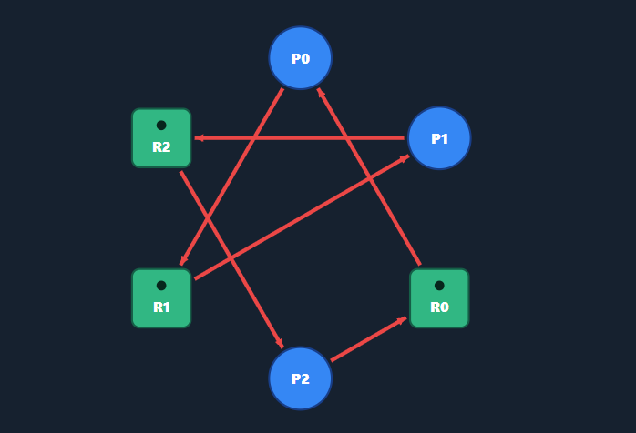
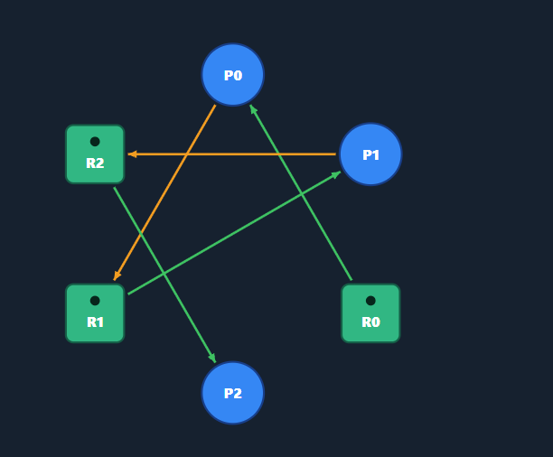
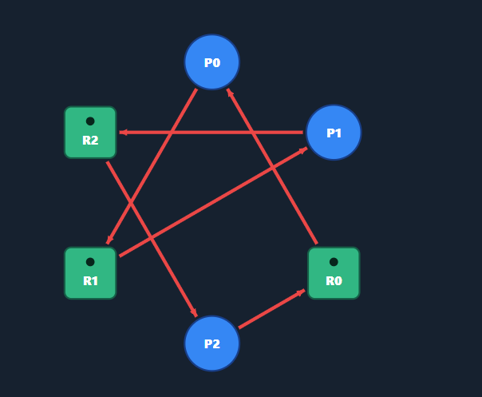
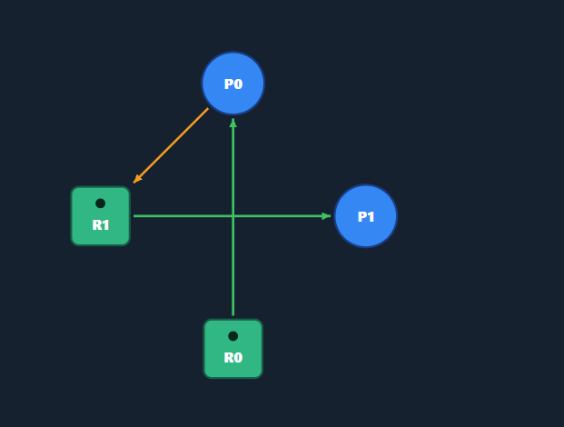

# Class Activity 7 - Reasoning About Deadlock

- **Student Name:** KHORN VICTOR
- **Student ID:** e20230078
- **My personalization:** a = [last digit], b = [second-to-last digit]

---

## Task 1 — Resource Allocation Graphs

### Part A

**Graph 1 — my prediction:** There is a cycle, and the system is deadlocked.

The cycle is:

P0 → R1 → P1 → R2 → P2 → R0 → P0

P0 holds R0 and waits for R1, P1 holds R1 and waits for R2, and P2 holds R2 and waits for R0. Each process is waiting for a resource held by another process. Therefore, nobody can continue or release their resources.

Matched the tool? Yes. The visualization confirmed that the graph contains a cycle and the system is deadlocked.

**Graph 2 — my prediction:** There is no cycle, and the system is not deadlocked.

P2 can finish first because it holds R2 and does not request another resource. After P2 releases R2, P1 can continue and finish. Finally, P0 can receive R1 and complete its execution.

The finishing order is:

P2 → P1 → P0

Matched the tool? Yes. The visualization confirmed that there is no cycle. All processes can finish without deadlock.

### Part B

**(i) Deadlocked 3×3 graph** — edges I used + why it deadlocks:

Processes: P0, P1, P2
Resources: R0, R1, R2
Edges:

- R0 → P0
- P0 → R1
- R1 → P1
- P1 → R2
- R2 → P2
- P2 → R0

The graph contains the cycle:
> P0 → R1 → P1 → R2 → P2 → R0 → P0

All three processes participate in the circular wait. Since every resource has one instance, the system is deadlocked.

**(ii) No-cycle graph (≥4 nodes, ≥1 request)** — why it is deadlock-free:

Processes: P0, P1
Resources: R0, R1
Edges:

- R0 → P0
- P0 → R1
- R1 → P1

P0 is waiting for R1, which is held by P1. However, P1 is not waiting for another resource, so it can finish and release R1. P0 can then continue. There is no cycle, and the system is not deadlocked.

---

## Task 2 — Cycle ≠ Deadlock

**Warm-up (built-in examples)**
1. Why the "Cycle, NO deadlock" example is not deadlocked: [...]
2. The single change that causes deadlock: [...]

**Part A — given scenario**
- Available = Total − ΣAlloc = [...]
- The cycle (as a path): [...]   Process in the cycle that can still finish + why: [...]

| Step | Process | Why Request ≤ Work | Work after release |
|------|---------|--------------------|--------------------|
| 1 | | | |
| 2 | | | |
| 3 | | | |

Conclusion: [DEADLOCKED / NOT deadlocked — finishing order = …]

After changing P3's request to `0 1 0` — my prediction + why it deadlocks (reduction terms):

**Part B — my own scenario**

My change that caused deadlock + why (reduction terms):

---

## Task 3 — Banker's Algorithm (my personalized scenario)

- Max[P0][A] = 7 + (a mod 3) = [...]   Max[P2][C] = 2 + (b mod 4) = [...]
- **Need matrix:** [...]
- **Available:** Total − ΣAlloc = [...]

**Safety trace (by hand):**

| Step | Process | Why Need ≤ Work | Work after release |
|------|---------|-----------------|--------------------|
| 1 | | | |
| 2 | | | |
| 3 | | | |

Conclusion: [SAFE — safe sequence = … / UNSAFE — because …]

Matched the tool? [...]

**Request I predicted GRANTED:** [process + vector], checks: [...]

**Request I predicted DENIED:** [process + vector], which check failed / why unsafe: [...]

---

## Task 4 — Semaphores and Deadlock

**Case 1 (s1=s2=s3=1) — my answer:** [YES / NO] — interleaving + wait-for cycle, or why no cycle can form:

Tool confirmed? [...]

**Case 2 (s1=s2=s3=1) — my answer:** [YES / NO] — [...]

Tool confirmed? [...]

**Case 3 (s1=2) — my answer:** [YES / NO] — what the extra instance of s1 does:

Tool confirmed? [...]

---

## Task 5 — Applied Concepts
1. [...]  2. [...]  3. [...]  4. [...]  5. [...]

---

## Reflection

_What did this activity teach you about why a cycle does not always mean deadlock, and about the trade-off between deadlock avoidance (Banker's) and detection + recovery in real systems such as databases or operating systems?_