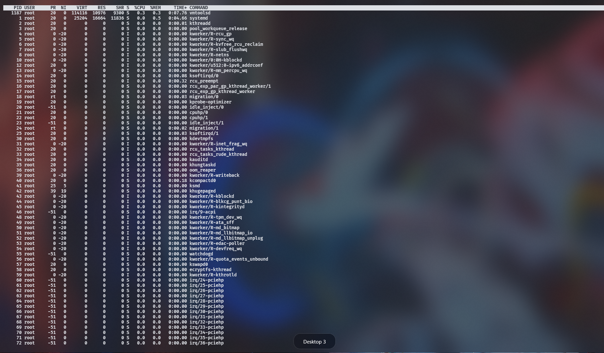
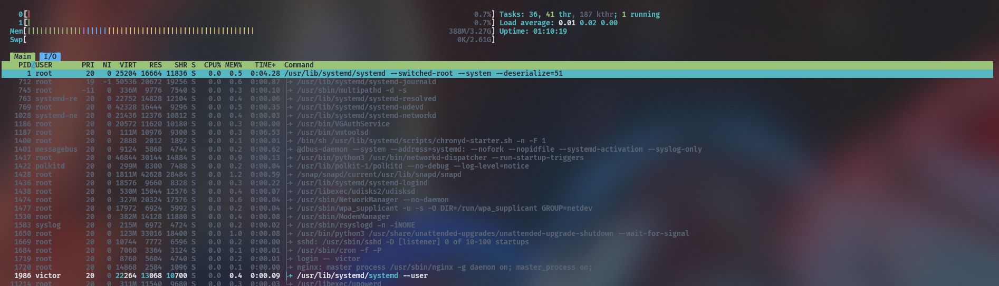
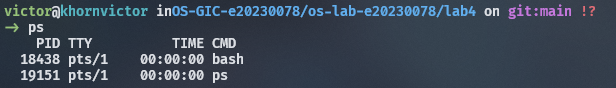
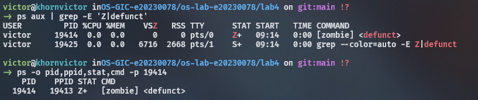
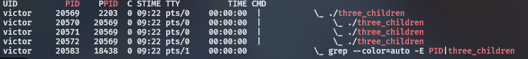
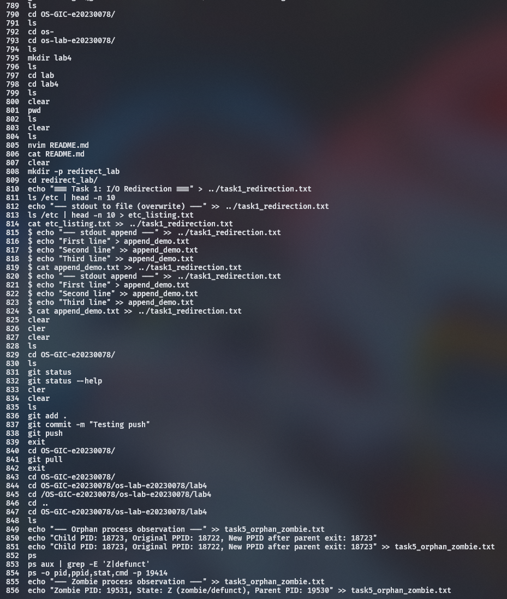

# OS Lab 4 Submission — I/O Redirection, Pipelines & Process Management

- **Student Name:** [Your Name Here]
- **Student ID:** [Your Student ID Here]

---

## Task Output Files

During the lab, each task redirected its output into `.txt` files. These files are your primary proof of work for the **guided portions** of each task. Make sure all of the following files are present in your `lab4/` folder:

- [ ] `task1_redirection.txt`
- [ ] `task2_pipelines.txt`
- [ ] `task3_analysis.txt`
- [ ] `task4_processes.txt`
- [ ] `task5_orphan_zombie.txt`
- [ ] `orphan.c`
- [ ] `zombie.c`
- [ ] `access.log`

---

## Screenshots

The screenshots below document the **interactive tools**, **process observations**, **challenge sections**, and **command history**.

---

### Screenshot 1 — Task 4: `top` Output

Show `top` running with the process list and column headers visible (PID, USER, %CPU, %MEM, COMMAND).

<!-- Insert your screenshot below: -->

---

### Screenshot 2 — Task 4: `htop` Tree View

Show `htop` in tree view (F5) displaying the process hierarchy with colored CPU/memory bars.

<!-- Insert your screenshot below: -->

---

### Screenshot 3 — Task 5: Orphan Process

Show the `ps` output proving the child process's PPID changed to 1 (or systemd PID) after the parent exited.

<!-- Insert your screenshot below: -->

---

### Screenshot 4 — Task 5: Zombie Process

Show the `ps` output with the zombie process visible — state `Z` or labeled `<defunct>`.

<!-- Insert your screenshot below: -->

---

### Screenshot 5 — Task 4 Challenge: Highest Memory Process

Show `top` sorted by memory usage with the top process identified.

<!-- Insert your screenshot below: -->

---

### Screenshot 6 — Task 5 Challenge: Process Tree with 3 Children

Show `ps --forest` output with the parent and 3 child processes visible.

<!-- Insert your screenshot below: -->

---

### Screenshot 7 — Command History

After finishing all tasks, run `history | tail -n 100` and take a screenshot.

<!-- Insert your screenshot below: -->

---

## Answers to Task 5 Questions

1. **How are orphans cleaned up?**
   > When a parent process exits while its child is still running, the child becomes an orphan. The Linux kernel immediately re-parents (adopts) the orphan process to `init`/`systemd` (PID 1) or the nearest ancestor registered as a subreaper (such as a `systemd --user` instance). The orphan continues executing normally until it finishes, at which point its new parent automatically calls `wait()`/`waitpid()` to collect its exit status and remove its entry from the process table.

2. **How are zombies cleaned up?**
   > A zombie process (`Z` state / `<defunct>`) has finished executing and freed its memory and resources, leaving only a process table entry (holding its PID and exit status) for its parent to read. It is cleaned up (reaped) when the parent calls `wait()` or `waitpid()` (for example, inside a `SIGCHLD` handler or explicitly as demonstrated in `zombie_reaped.c`). If the parent exits without waiting, `init`/`systemd` (PID 1) or a subreaper adopts the zombie and calls `wait()` to remove it from the process table.

3. **Can you kill a zombie with `kill -9`? Why or why not?**
   > No. `kill -9` sends `SIGKILL`, which terminates a running process, but a zombie is **already dead**—it has finished executing and no longer has running code or user-space memory (`VSZ = 0`, `RSS = 0`) to act on signals. Its process table entry remains solely so its parent can read its exit status. To clear a lingering zombie whose parent does not call `wait()`, you must prompt the parent to reap it or terminate the **parent process** (PPID) so PID 1 adopts and reaps the zombie.

---

## Reflection

> The most useful technique I learned in this lab was chaining Linux pipelines (`|`) with text-processing filters like `grep`, `cut`, `awk`, `sort`, and `uniq -c`, alongside process inspection and control commands (`ps --forest`, `pgrep`, `pkill`, `kill`, and `nohup`). Together, they make it easy to turn raw logs and command output into clear summaries and manage background jobs reliably.
>
> In a real server environment, I would use **pipelines** to troubleshoot logs and system resources in real time—for instance, filtering web server logs (`access.log`) with `grep` for `4xx`/`5xx` errors, extracting client IPs or paths with `awk`, and ranking top offending IPs or endpoints with `sort | uniq -c | sort -rn | head`, or piping `ps` and `du` output through `sort` to pinpoint high-memory processes and large directories. I would use **I/O redirection** (`>`, `>>`, `2>`, `2>&1`, and `tee`) for background services, deployment scripts, and `cron` jobs to separate normal output (`stdout`) from error logs (`stderr`), preserve live + logged output with `tee -a`, and ensure unattended processes started with `nohup` retain all diagnostic output.

